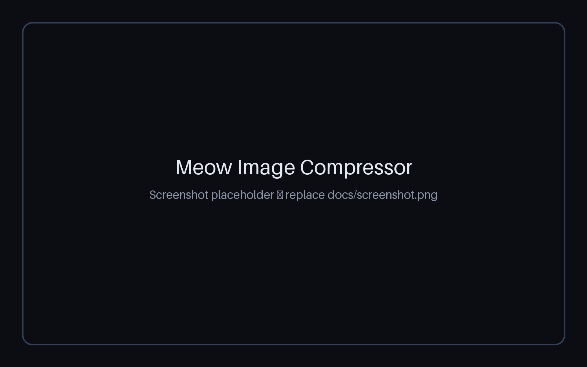

<p align="center"></p>

<h1 align="center">Meow Image Compressor</h1>

<p align="center">
  <a href="LICENSE"></a>
  
  
</p>

**Private, offline and unlimited image compression that runs entirely in your browser.**
A free, open-source alternative to online compressors: no uploads, no accounts, no file-count or file-size limits.

<!-- Replace docs/screenshot.png with a real screenshot (suggested size: 1600×1000, dark theme). -->


## Features

- 🔒 **100% local**: files never leave your device. Works with no internet after the first load.
- ♾️ **No limits**: any number of files, any size (bounded only by your device's memory).
- 🧠 **Modern codecs, compiled to WebAssembly**

  | Format | Engine | Notes |
  | --- | --- | --- |
  | PNG (libimagequant) | libimagequant + OxiPNG | Perceptual palette with dithering, usually the best lossy PNG |
  | PNG (UPNG) | UPNG + OxiPNG | Faster quantiser; quality 100 = fully lossless |
  | JPEG | MozJPEG | Transparency is flattened onto white |
  | WebP | libwebp | Slowest / best method |
  | AVIF | libavif (AOM) | Best size-to-quality ratio, slowest to encode |
  | JPEG XL | libjxl | Lossy, or lossless at quality 100 |
  | SVG | SVGO | Multipass optimisation, vectors stay vectors |

- ▶️ **Manual control**: add files first, then press **Process all** or **Process** on a single file.
- 🔍 **Before/after slider** with wheel zoom, pan and a pixel-level 1:1 view.
- ⚡ **Parallel**: a Web Worker pool uses your CPU cores without freezing the UI.
- 📐 Optional resize (max side) and automatic metadata stripping (EXIF/ICC are dropped by re-encoding).
- 🛡️ Never makes a file bigger: if the result is larger than a same-format original, the original is kept.
- 📋 Drag & drop, file picker, clipboard paste, per-file remove (✕), batch **ZIP** download.
- 🌗 Dark and light themes with a one-click switch (Auto / Light / Dark; Auto follows your system).
- 📲 **Installable PWA**: install it like a native app; it works offline after the first load.

## Quick start

Requires [Node.js](https://nodejs.org) 18 or newer.

```bash
git clone https://github.com/tx2x/Meow-Image-Compressor.git
cd Meow-Image-Compressor
npm install
npm run dev        # development server
npm run build      # production build in ./dist
npm run preview    # serve the production build
```

### Using it fully offline

`npm run build` outputs a static site in `dist/` with every WASM codec bundled and **zero external requests**.
Serve it with any static server (WASM and module workers do not work from `file://`):

```bash
npx serve dist        # or: python -m http.server -d dist
```

You can also host it on GitHub Pages, a NAS or an intranet.

### Install as an app (PWA)

Open the served site in Chrome, Edge or Safari and choose **Install** / **Add to Home Screen**.
On the first visit all files (about 10 MB, including every codec) are cached, so the app keeps working with no connection.
Browsers only allow installation from `https://` or `http://localhost`; a plain `http://<LAN-IP>` works as a normal website but is not installable.

## Usage

1. Pick an output format (**Select format...**) and adjust quality (and optionally the max side).
2. Drop, paste or browse for images.
3. Press **Process all**, or **Process** on individual files.
4. Use **Compare** to inspect the result, then **Download** or **Download all (ZIP)**.

Changing settings after processing keeps the existing results but marks them as outdated; use **Redo** or **Process all** to apply the new settings.

## How it works

1. The browser decodes the image (`createImageBitmap`) and optionally resizes it on a canvas.
2. Raw RGBA pixels are sent to a worker that encodes them with the selected WASM codec.
3. The result is shown with the savings and can be downloaded individually or as a ZIP.

## Project structure

```
index.html            App shell
src/main.js           UI, queue and worker pool
src/worker.js         Codecs (run off the main thread)
src/compare.js        Before/after slider
src/theme.js          Auto / light / dark theme
src/style.css         Styles
public/               PWA manifest and icons (icon.svg is the logo)
vite.config.js        Build config + offline service worker generator
docs/                 Screenshot
```

## Browser support and limitations

- Recent Chromium, Firefox and Safari. Input formats are whatever your browser can decode (PNG, JPEG, WebP, GIF, BMP, SVG, usually AVIF).
- Animated GIFs are flattened to the first frame. SVG files can also be rasterised to any bitmap format.
- Very large images are limited by browser memory; AVIF and JPEG XL are CPU-intensive.
- Most browsers cannot display `.jxl` files; the in-app preview decodes them for you.

## Roadmap

- Per-file settings and presets
- SVG → raster size control
- Resizing by percentage and format-specific advanced options

## Contributing

Issues and pull requests are welcome. Please keep the project dependency-light and fully offline-capable.

## Credits

[jSquash](https://github.com/jamsinclair/jSquash) (Squoosh codecs), [libimagequant-wasm](https://www.npmjs.com/package/libimagequant-wasm),
[UPNG.js](https://github.com/photopea/UPNG.js), [SVGO](https://github.com/svg/svgo), [fflate](https://github.com/101arrowz/fflate), [Vite](https://vitejs.dev).

The code was written using web version of Claude Sonnet 5.5 😁.

## License

[MIT](LICENSE)
