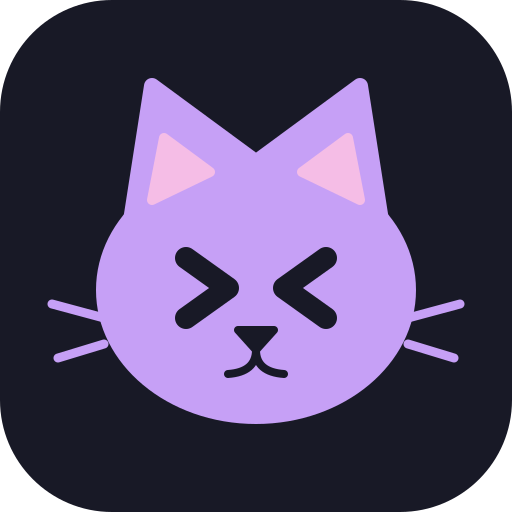
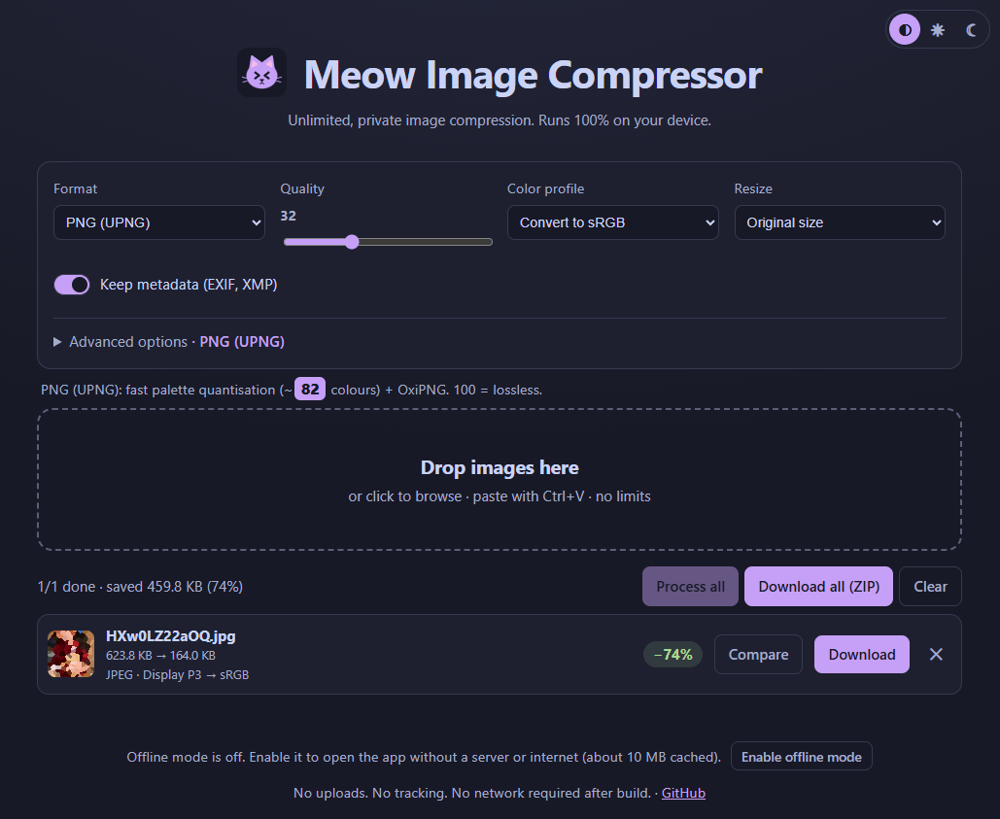

<p align="center"></p>

<h1 align="center">Meow Image Compressor</h1>

<p align="center">
  <a href="LICENSE"></a>
  
  
</p>

**Private, offline and unlimited image compression that runs entirely in your browser.**
A free, open-source alternative to online compressors: no uploads, no accounts, no file-count or file-size limits.



## Features

- 🔒 **100% local**: files never leave your device. Works with no internet after the first load.
- ♾️ **No limits**: any number of files, any size (bounded only by your device's memory).
- 🧠 **Modern codecs, compiled to WebAssembly**

  | Format | Engine | Notes |
  | --- | --- | --- |
  | PNG (libimagequant) | libimagequant + OxiPNG | Perceptual palette with dithering, usually the best lossy PNG |
  | PNG (UPNG) | UPNG + OxiPNG | Faster quantiser; quality 100 = fully lossless |
  | JPEG | MozJPEG | Transparency is flattened onto white |
  | WebP | libwebp | Slowest / best method |
  | AVIF | libavif (AOM) | Best size-to-quality ratio, slowest to encode |
  | JPEG XL | libjxl | Lossy, or lossless at quality 100 |
  | SVG | SVGO | Multipass optimisation, vectors stay vectors |

- ▶️ **Manual control**: add files first, then press **Process all** or **Process** on a single file.
- 🔍 **Before/after slider** with wheel zoom, pan and a pixel-level 1:1 view.
- ⚡ **Parallel**: a Web Worker pool uses your CPU cores without freezing the UI.
- 🎨 **Colour profiles**: embedded ICC profiles (e.g. Display P3) are detected and shown per file. Choose to **convert to sRGB** (default) or **keep the original profile** (PNG, JPEG, WebP). See [Colour profiles](#colour-profiles).
- 🗂️ **Metadata switch**: strip EXIF/XMP (default) or **keep** it (PNG, JPEG, WebP, and SVG). See [Metadata](#metadata).
- 📐 **Resize** by percentage or by longest side, including precise control of the size when an **SVG is converted to a bitmap**. See [Resizing](#resizing).
- 🎛️ **Advanced options for every format** (OxiPNG effort, dithering, chroma subsampling, lossless modes, encoder effort, SVG precision and more). See [Advanced options](#advanced-options).
- 🛡️ Never makes a file bigger: if the result is larger than a same-format original, the original is kept.
- 📋 Drag & drop, file picker, clipboard paste, per-file remove (✕), batch **ZIP** download.
- 🌗 Dark ([Catppuccin Macchiato](https://catppuccin.com/palette/)) and light (Catppuccin Latte) themes with a one-click switch (Auto / Light / Dark; Auto follows your system).
- 🚀 One-click launch with `start.bat` / `start.sh`: installs, builds, starts the server and opens your browser. Never starts a second copy by accident.
- 📲 **Optional offline mode (PWA)**: opt in with one click in the footer to cache the app in your browser so it opens without a server or internet. Off by default, removable at any time.

## Quick start

Requires [Node.js](https://nodejs.org) 18 or newer.

```bash
git clone https://github.com/tx2x/Meow-Image-Compressor.git
cd Meow-Image-Compressor
```

**The easy way**: run the launcher for your OS. On the first run it installs the dependencies and builds the app, then starts the server and opens the web interface in your browser.

| OS | Command |
| --- | --- |
| Windows | double-click `start.bat` (or run it in a terminal) |
| macOS / Linux | `./start.sh` (if needed: `chmod +x start.sh`, or `sh start.sh`) |

**With npm**:

```bash
npm install
npm start            # build if needed, serve and open the browser (Ctrl+C to stop)
npm run start:lan    # same, but reachable from other devices on your network
npm run dev          # development server with hot reload
npm run build        # production build in ./dist
```

Launcher options (after `npm start --` or as arguments of `start.sh` / `start.bat`): `--no-open` (do not open the browser), `--lan`, `--dev`.

On Windows, `start.bat` opens the server in its **own console window**: pressing **Ctrl+C** or closing that window stops the server immediately, with no "Terminate batch job (Y/N)?" question. (That question is produced by `cmd` for any batch file that is still running, so `npm start`, whose `npm.cmd` is a batch file, may still show it. Use `start.bat` or `node scripts/start.mjs` directly to avoid it.)

### Only one copy at a time

If Meow Image Compressor is already running, starting it again does **not** silently open another server on a different port. The launcher tells you where it is running and asks what to do:

```
Meow Image Compressor is already running:
  http://localhost:4173/

  [C] Cancel (default)   [S] Start another instance   [O] Open the running one in the browser:
```

Just press **Enter** to cancel, **S** to start another instance anyway (it picks the next free port) or **O** to open the running one.

### Using it fully offline

`npm run build` outputs a static site in `dist/` with every WASM codec bundled and **zero external requests**.
Serve it with any static server (WASM and module workers do not work from `file://`):

```bash
npx serve dist        # or: python -m http.server -d dist
```

You can also host it on GitHub Pages, a NAS or an intranet.

### Offline mode and installing as an app (optional)

Offline mode is **off by default**: nothing is cached and no background worker is registered until you ask for it.
Open the served site and click **Enable offline mode** in the footer. About 10 MB (including every codec) is cached in your browser, and the app then opens
without a server or internet. You can also **Install** it from the browser menu (Chrome, Edge) or **Add to Home Screen** (Safari).
Click **Disable and clear cache** at any time to turn it off again.
Browsers only offer this on `https://` or `http://localhost`; a plain `http://<LAN-IP>` works as a normal website without offline mode.

## Stopping the server

`start.bat`, `start.sh`, `npm start` and `npm run dev` are ordinary foreground processes. They are never installed as a service, never start with your system, and stop when you:

- press **Ctrl+C** in the terminal where they run, or
- close that terminal window.

If a port is still busy (dev uses 5173, preview uses 4173):

```bash
# macOS / Linux
lsof -i :4173          # note the PID
kill <PID>

# Windows (PowerShell)
netstat -ano | findstr :4173
taskkill /PID <PID> /F
```

### The page still opens after the server is stopped or the PC is restarted?

That is the browser's offline cache (Offline mode / an installed app), not a running server. To turn it off:

1. Click **Disable and clear cache** in the footer of the app, **or**
2. Chrome / Edge: press F12 → **Application** → **Service workers** → *Unregister*, then **Storage** → *Clear site data*. Firefox: DevTools → **Storage**, or clear site data for `localhost` in the browser settings.
3. If you installed it as an app, uninstall it (`chrome://apps` → right-click → *Remove*), and check that it is not set to start when you sign in.

If you ran an earlier test build that cached the app automatically, just open the app once while the server is running: it removes the old cache by itself.

## Usage

1. Pick an output format (**Select format...**), adjust quality, and choose resizing, colour-profile and metadata behaviour. Open **Advanced options** for format-specific settings.
2. Drop, paste or browse for images.
3. Press **Process all**, or **Process** on individual files.
4. Use **Compare** to inspect the result, then **Download** or **Download all (ZIP)**.

Changing settings after processing keeps the existing results but marks them as outdated; use **Redo** or **Process all** to apply the new settings.

## Resizing

| Mode | Bitmaps (PNG, JPEG, WebP, ...) | SVG converted to a bitmap |
| --- | --- | --- |
| **Original size** | unchanged | natural size from `width`/`height`, else the `viewBox` (1024 px if neither exists) |
| **Scale (%)** | percentage of the original size (1–400 %) | percentage of the natural size, rendered as a vector (crisp at any size) |
| **Max side (px)** | the longest side is reduced to this value; smaller images are left alone | the longest side is set to exactly this value, up or down |

Choosing **SVG (SVGO)** as the output keeps the file a vector and ignores resizing.

## Advanced options

Open **Advanced options** in the settings panel; it shows the options of the selected format and remembers them per format while the page is open. The quality slider still sets the basic quality.

| Format | Options |
| --- | --- |
| PNG (UPNG) | Max colours (0 = auto from quality), OxiPNG effort, interlaced (Adam7), optimise transparent pixels |
| PNG (libimagequant) | Max colours, dithering, quantiser speed, OxiPNG effort, interlaced, optimise transparent pixels |
| JPEG (MozJPEG) | Progressive, chroma subsampling (auto / 4:4:4 / 4:2:0), quantisation table, trellis optimisation |
| WebP | Lossless, effort (0–6), near-lossless, sharp YUV, keep colour of transparent pixels |
| AVIF | Lossless, speed (0–10), chroma subsampling (4:2:0 / 4:2:2 / 4:4:4), sharp YUV |
| JPEG XL | Lossless, effort (1–9), progressive |
| SVG (SVGO) | Number precision (0 = auto from quality), multipass, pretty-print |

## Metadata

The **Keep metadata (EXIF, XMP)** switch is off by default, so results are stripped of metadata (smaller files, better privacy). When it is on:

- **EXIF and XMP** are copied into **PNG, JPEG and WebP** results, also between these formats (for example JPEG → WebP). PNG text chunks (`tEXt`, `zTXt`, `iTXt`) are kept for PNG → PNG.
- The EXIF **Orientation** tag is reset to 1, because the browser has already rotated the pixels; this prevents images from being rotated twice.
- **SVG** output keeps `<metadata>`, comments, editor data and `<desc>`.
- **AVIF and JPEG XL** cannot carry EXIF/XMP in this build, so metadata is removed for them (the app tells you).
- Limits: IPTC (APP13) data is not copied, JPEG EXIF/XMP larger than 64 KB is skipped, and EXIF pixel-dimension fields are not updated when you resize.

Colour profiles are controlled separately; see below.

## Colour profiles

Some images carry an embedded ICC profile (for example **Display P3**). Squeezing the raw pixel values and dropping the profile would make such images look washed out or shifted, so Meow Image Compressor handles them explicitly. The profile name is shown on each file's third line (e.g. `JPEG · Display P3`), and after processing it shows what happened (`→ sRGB` or `→ kept`).

| Setting | What happens |
| --- | --- |
| **Convert to sRGB** (default) | Pixels are converted to sRGB by the browser's colour management before encoding, and the output has no profile. Best compatibility; colours outside the sRGB gamut are clipped. |
| **Keep original profile** | Pixels are decoded without conversion and the original profile is embedded in the result, so wide-gamut colours are preserved. Supported for **PNG, JPEG and WebP**. |

Notes:

- AVIF and JPEG XL cannot embed profiles in this build, so with *Keep original profile* they are converted to sRGB (the app tells you).
- If your browser does not support decoding without conversion, the image is safely converted to sRGB instead of being tagged incorrectly.
- Non-RGB profiles (grayscale, CMYK) are always converted to sRGB.
- If the original is kept because the result would be bigger, its original profile stays with it.

## How it works

1. The browser decodes the image (`createImageBitmap`) and optionally resizes it on a canvas.
2. Raw RGBA pixels are sent to a worker that encodes them with the selected WASM codec.
3. The result is shown with the savings and can be downloaded individually or as a ZIP.

## Project structure

```
start.bat / start.sh  One-click launchers (Windows / macOS, Linux)
scripts/start.mjs     Cross-platform launcher: build, serve, open browser, single-instance guard
index.html            App shell
src/main.js           UI, queue and worker pool
src/worker.js         Codecs (run off the main thread)
src/icc.js            ICC profile detection and embedding (PNG, JPEG, WebP)
src/meta.js           EXIF / XMP preservation (PNG, JPEG, WebP)
src/options.js        Quality + advanced options -> encoder options
src/advanced.js       Format-specific advanced controls
src/svg.js            SVG size detection and vector re-sizing
src/compare.js        Before/after slider
src/offline.js        Opt-in offline mode
src/theme.js          Auto / light / dark theme (Catppuccin)
src/style.css         Styles
public/               PWA manifest and icons (icon.svg is the logo)
vite.config.js        Build config + offline service worker generator
docs/                 Screenshot
```

## Browser support and limitations

- Recent Chromium, Firefox and Safari. Input formats are whatever your browser can decode (PNG, JPEG, WebP, GIF, BMP, SVG, usually AVIF).
- Animated GIFs are flattened to the first frame. SVG files can also be rasterised to any bitmap format.
- Very large images are limited by browser memory; AVIF and JPEG XL are CPU-intensive.
- Most browsers cannot display `.jxl` files; the in-app preview decodes them for you.
- Colour conversion relies on your browser's colour management, so results can differ slightly between browsers.
- AVIF is always encoded at 8-bit depth.

## Roadmap

- Per-file settings and presets
- Remember settings between sessions
- Presets for common targets (web, email, print)

## Contributing

Issues and pull requests are welcome. Please keep the project dependency-light and fully offline-capable.

## Credits

[jSquash](https://github.com/jamsinclair/jSquash) (Squoosh codecs), [libimagequant-wasm](https://www.npmjs.com/package/libimagequant-wasm),
[UPNG.js](https://github.com/photopea/UPNG.js), [SVGO](https://github.com/svg/svgo), [fflate](https://github.com/101arrowz/fflate), [Vite](https://vitejs.dev), and the [Catppuccin](https://catppuccin.com) palette (Macchiato and Latte).

The code was written using web version of Claude Sonnet 5.5 😁.

## License

[MIT](LICENSE)
